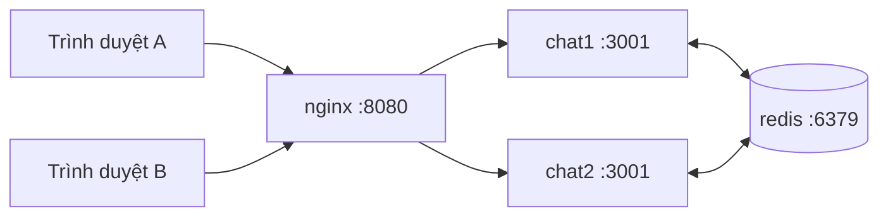

# Chạy ChatMatch bằng Docker (nhiều instance + Redis)

Tài liệu này hướng dẫn dựng cụm demo gồm **1 Redis + 2 server Node.js + 1 Nginx load balancer** chỉ bằng một lệnh.

## 1. Kiến trúc



| Service | Cổng trên máy host | Vai trò |
| :--- | :--- | :--- |
| `nginx` | `8080` | Load balancer round-robin, nâng cấp HTTP → WebSocket |
| `chat1` | `3001` | Instance Node.js thứ nhất (`USE_REDIS=true`) |
| `chat2` | `3002` | Instance Node.js thứ hai (`USE_REDIS=true`) |
| `redis` | `6379` | Hàng đợi ghép cặp, bộ đếm online, Pub/Sub |

Các file liên quan: [`Dockerfile`](../Dockerfile), [`docker-compose.yml`](../docker-compose.yml), [`nginx/nginx.conf`](../nginx/nginx.conf), [`.dockerignore`](../.dockerignore).

## 2. Yêu cầu
- [Docker Desktop](https://www.docker.com/products/docker-desktop/) (Windows/macOS) hoặc Docker Engine + Compose plugin (Linux).

## 3. Chạy

```bash
# Tại thư mục gốc dự án
docker compose up --build
```

Mở **http://localhost:8080** ở 2 trình duyệt (hoặc 1 tab thường + 1 tab ẩn danh) rồi bấm tìm người.

Dừng và xóa container:
```bash
docker compose down
```

## 4. Kiểm chứng Redis Pub/Sub hoạt động

1. Xem log cả hai instance:
   ```bash
   docker compose logs -f chat1 chat2
   ```
   Mỗi instance phải in ra các dòng `[Redis] ✅ Pub Client đã kết nối...` và `[Redis] 📡 Đã kích hoạt lắng nghe Pub/Sub đa instance`.
2. Cách chắc chắn nhất để 2 người nằm ở 2 instance khác nhau: người A mở **http://localhost:3001**, người B mở **http://localhost:3002**. Hai người vẫn ghép cặp và chat được với nhau → tin nhắn đi qua Redis.
3. Soi trực tiếp Redis:
   ```bash
   docker compose exec redis redis-cli PSUBSCRIBE "chat:*"
   ```

## 5. Chạy kiểm thử tải qua load balancer
```bash
node tests/load-test.js 100 ws://localhost:8080
```
> Mọi kết nối từ máy bạn có cùng IP, nên giới hạn `MAX_CONNECTIONS_PER_IP` (mặc định 100) áp dụng **cho từng instance**. Khi test số lượng lớn, thêm `MAX_CONNECTIONS_PER_IP: "1000"` vào phần `environment` trong `docker-compose.yml`.

## 6. Giới hạn cần biết (quan trọng khi demo)

- **Trạng thái ván Caro, rate limit, report/ban vẫn nằm trong RAM của từng instance** (xem [REDIS_GUIDE.md](./REDIS_GUIDE.md#2-trạng-thái-dùng-chung-và-chế-độ-fallback)). Vì vậy ghép cặp và chat văn bản hoạt động liên instance, nhưng minigame Caro giữa 2 người ở 2 instance khác nhau có thể không đồng bộ. Khi cần demo Caro, hãy cho cả hai người vào cùng một instance (cùng `localhost:3001`).
- **Không đặt `NODE_ENV=production`** khi demo trên một máy: chế độ này bật `DISALLOW_SAME_DEVICE`, hai tab cùng trình duyệt sẽ không ghép được với nhau.
- Ứng dụng **không tự nạp file `.env`**; mọi cấu hình trong Docker được truyền qua mục `environment` của `docker-compose.yml`.
- Tính năng đính kèm (Azure Blob) và Google Web Risk mặc định tắt. Muốn bật, thêm các biến tương ứng trong `backend/.env.example` vào `environment` (dùng secret, không commit giá trị thật).

## 7. Xử lý sự cố

| Triệu chứng | Nguyên nhân / Cách xử lý |
| :--- | :--- |
| `port is already allocated` | Cổng 8080/3001/3002/6379 đang bị dùng (ví dụ đang chạy `node server.js` hoặc Redis local). Tắt tiến trình đó hoặc đổi cổng bên trái trong `ports`. |
| Trang mở được nhưng trạng thái "Đang kết nối..." mãi | Kiểm tra `nginx/nginx.conf` còn các header `Upgrade`/`Connection`; xem `docker compose logs nginx`. |
| Báo lỗi không tìm được người | Redis chưa sẵn sàng; xem `docker compose ps` và log `redis`. |
| Sửa code nhưng không thấy thay đổi | Build lại: `docker compose up --build`. |

